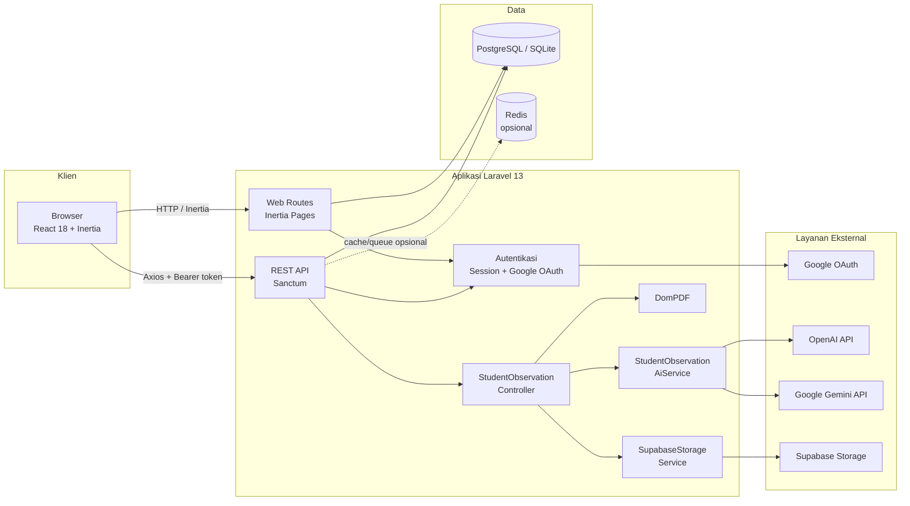
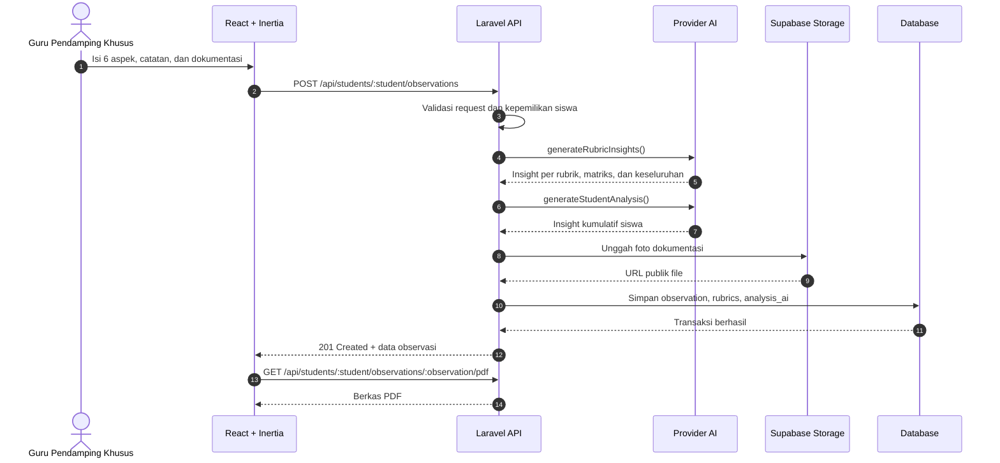

# PendampingKu

Platform web untuk membantu Guru Pendamping Khusus (GPK) mencatat observasi harian, menganalisis capaian perkembangan siswa secara terstruktur, dan menghasilkan laporan observasi dalam format PDF.

- **Kategori:** Web Application
- **Event:** Hackathon LOGICODIX 2026
- **Nama Tim:** `JAYA3X`

---

## Daftar Isi

1. [Project Overview](#1-project-overview)
2. [Team Members](#2-team-members)
3. [Key Features](#3-key-features)
4. [Technology Stack](#4-technology-stack)
5. [System Architecture](#5-system-architecture)
6. [Installation and Configuration](#6-installation-and-configuration)
7. [Environment Variables](#7-environment-variables)
8. [Demo Account](#8-demo-account)
9. [AI Usage](#9-ai-usage)
10. [API Reference](#10-api-reference)
11. [Credits and Attribution](#11-credits-and-attribution)
12. [Struktur Repository](#12-struktur-repository)
13. [Batasan dan Catatan Keamanan](#13-batasan-dan-catatan-keamanan)

---

## 1. Project Overview

### Identitas Aplikasi

| Item | Keterangan |
|---|---|
| Nama aplikasi | PendampingKu |
| Nama tim | `JAYA3X` |
| Kategori | Web Application |
| Target rilis | Submission Hackathon LOGICODIX 2026 |

### Deskripsi

PendampingKu adalah aplikasi web yang dirancang untuk mendukung pekerjaan Guru Pendamping Khusus di sekolah inklusi. Aplikasi ini menyediakan alur pencatatan observasi harian yang terstruktur, analisis capaian berbasis enam aspek perkembangan, serta laporan observasi yang dapat diunduh sebagai PDF.

Setiap catatan observasi disusun dari indikator rubrik yang tersebar dalam enam aspek: Regulasi Emosi, Regulasi Perilaku, Kemandirian, Komunikasi, Interaksi Sosial, dan Perkembangan Akademik. Data observasi kemudian diolah menjadi insight per indikator, insight per aspek, dan analisis kumulatif siswa.

### Tujuan Pengembangan

1. Mengurangi beban administrasi GPK dalam mendokumentasikan sesi pendampingan.
2. Menyeragamkan format observasi agar data perkembangan siswa lebih konsisten.
3. Membantu GPK mengidentifikasi kekuatan dan area yang masih memerlukan dukungan.
4. Menyediakan riwayat observasi dan laporan PDF yang mudah diakses kembali.
5. Menyediakan fondasi data yang terstruktur untuk evaluasi pendampingan berikutnya.

### Permasalahan yang Ingin Diselesaikan

- Pencatatan observasi sering dilakukan secara terpisah-pisah sehingga sulit dianalisis.
- Narasi laporan membutuhkan waktu lama karena harus disusun ulang dari catatan mentah.
- Perkembangan siswa sulit dipantau secara konsisten ketika data tidak terpusat.
- Dokumentasi sesi pendampingan dan hasil intervensi tidak selalu tersimpan rapi.

### Solusi yang Ditawarkan

PendampingKu menggabungkan pencatatan observasi, rubrik terstruktur, analisis AI, riwayat, dan ekspor PDF dalam satu aplikasi web. GPK dapat mengisi observasi melalui formulir dua langkah, mengunggah dokumentasi foto, lalu melihat ringkasan capaian pada halaman laporan siswa.

### Target Pengguna

| Pengguna | Peran dalam aplikasi |
|---|---|
| Guru Pendamping Khusus (GPK) | Pengguna utama yang mengelola data siswa dan catatan observasi |

---

## 2. Team Members

| No. | Nama | Role |
|---|---|---|
| 1 | `Novian Ariansyah` | `PM` |
| 2 | `Keyla Hayu Anjani` | `UI/UX` |
| 3 | `Achmad Hasbil Wafi Rahmawan` | `DEVELOPER` |


---

## 3. Key Features

| Fitur | Fungsi | Manfaat |
|---|---|---|
| Autentikasi akun | Registrasi, login email/password, login Google, reset password, dan logout | GPK dapat mengakses data secara aman melalui akun masing-masing |
| Dashboard | Menampilkan jumlah siswa aktif, siswa yang belum diobservasi hari ini, laporan siap kirim, dan aktivitas terbaru | Memberi gambaran cepat kondisi pendampingan harian |
| Manajemen siswa binaan | Tambah, lihat, edit, cari, dan filter siswa berdasarkan kelas serta jenis disabilitas | Data siswa terpusat dan mudah ditemukan |
| Observasi harian terstruktur | Formulir dua langkah dengan 24 indikator rubrik, skala bantuan 0–4, dan opsi N/O | Menghasilkan data observasi yang konsisten dan terukur |
| Analisis AI per catatan | Insight dan rekomendasi per indikator, per aspek, dan keseluruhan catatan | Membantu GPK menafsirkan data observasi secara lebih cepat |
| Analisis kumulatif siswa | Merangkum seluruh histori observasi menjadi insight siswa dan analisis capaian enam aspek | Memudahkan pemantauan perkembangan jangka panjang |
| Rekomendasi naratif AI | Menghasilkan rekomendasi dari catatan lapangan melalui tombol khusus | Membantu menyusun narasi tindak lanjut |
| Dokumentasi sesi | Unggah 1–5 foto JPG/PNG dengan ukuran maksimal 5 MB per file | Bukti visual sesi tersimpan bersama catatan |
| Laporan siswa | Radar chart enam aspek, skor capaian, insight AI, dan riwayat observasi | Mempermudah evaluasi dan diskusi tindak lanjut |
| Ekspor PDF | Mengunduh catatan observasi dalam format A4 | Laporan dapat dicetak atau dibagikan kepada pihak terkait |
| REST API | Endpoint API dengan autentikasi Sanctum | Memungkinkan pengembangan klien lain, termasuk aplikasi mobile |
| Profil pengguna | Ubah nama/email, ubah kata sandi, dan hapus akun | Pengguna dapat mengelola akunnya sendiri |

### 3.1 Observasi Harian Dua Langkah

Formulir observasi dipisahkan menjadi dua halaman:

1. **Halaman observasi** berisi tanggal, waktu, mata pelajaran, emosi, dan penilaian indikator rubrik.
2. **Halaman catatan dan tindak lanjut** berisi aktivitas pembelajaran, hasil sesi, rencana tindak lanjut, strategi, dokumentasi, serta opsi laporan orang tua dan diskusi guru.

Skala rubrik yang digunakan:

| Skor | Label | Makna |
|---|---|---|
| 4 | Mandiri | Tanpa prompt |
| 3 | Bantuan Minimal | Prompt gestur atau verbal |
| 2 | Bantuan Sedang | Modeling dan verbal |
| 1 | Bantuan Maksimal | Bimbingan fisik penuh |
| 0 | Belum Tercapai | Menolak atau menunjukkan resistensi |
| N/O | Tidak Diamati | Tidak dinilai dan tidak dihitung sebagai skor 0 |

### 3.2 Enam Aspek Perkembangan

| Kode | Aspek | Jumlah Indikator |
|---|---|---|
| A | Regulasi Emosi | 4 |
| B | Regulasi Perilaku | 4 |
| C | Kemandirian | 4 |
| D | Komunikasi | 4 |
| E | Interaksi Sosial | 4 |
| F | Perkembangan Akademik | 4 |

### 3.3 Laporan Siswa

Halaman laporan menampilkan:

- Radar chart skor rata-rata per aspek.
- Total skor dan persentase capaian per aspek.
- Insight keseluruhan siswa dan insight per aspek dari AI.
- Riwayat observasi dengan pencarian, pengurutan, dan filter tanggal.
- Tautan ke detail catatan dan unduhan PDF.

### 3.4 Notifikasi

Aplikasi menampilkan notifikasi global di pojok kanan bawah untuk aksi berikut:

- Berhasil atau gagal menambah siswa.
- Berhasil atau gagal memperbarui data siswa.
- Berhasil menyimpan catatan harian.
- Gagal mengunduh PDF setelah catatan tersimpan.
- Berhasil atau gagal memperbarui profil.
- Berhasil atau gagal memperbarui kata sandi.

---

## 4. Technology Stack

### 4.1 Frontend

| Teknologi | Versi | Fungsi |
|---|---|---|
| React | 18 | Library antarmuka pengguna |
| Inertia.js React | 2 | Menghubungkan halaman Laravel dengan komponen React |
| Tailwind CSS | 4 | Styling dan design system |
| Vite | 8 | Build tool dan development server |
| Motion | 14 | Animasi antarmuka dan transisi |
| Recharts | 3 | Radar chart capaian siswa |
| Headless UI | 2 | Komponen UI aksesibel |

### 4.2 Backend

| Teknologi | Versi | Fungsi |
|---|---|---|
| PHP | 8.3+ | Bahasa pemrograman backend |
| Laravel | 13 | Framework aplikasi dan routing |
| Inertia Laravel | 2 | Render halaman Inertia dari sisi server |
| Laravel Sanctum | 4 | Autentikasi token untuk API |
| Laravel Socialite | 5 | Integrasi Google OAuth |
| barryvdh/laravel-dompdf | 3 | Pembuatan PDF catatan observasi |
| Ziggy | 2 | Penggunaan named route Laravel di frontend |

### 4.3 Database dan Penyimpanan

| Teknologi | Fungsi |
|---|---|
| PostgreSQL 17 | Database utama pada konfigurasi Docker Compose |
| SQLite | Alternatif database untuk pengembangan lokal |
| Supabase Storage | Penyimpanan foto dokumentasi observasi |

### 4.4 API dan Integrasi

| Layanan | Fungsi |
|---|---|
| Google OAuth 2.0 | Login dan registrasi menggunakan akun Google |
| OpenAI API | Analisis observasi dan rekomendasi naratif |
| Google Gemini API | Alternatif provider AI |
| Supabase Storage API | Unggah dan akses dokumentasi observasi |

### 4.5 Infrastructure dan Deployment

| Teknologi | Fungsi |
|---|---|
| Docker | Menjalankan aplikasi dalam container |
| Docker Compose | Orkestrasi Laravel, Node, PostgreSQL, dan Redis |
| Node.js 22 Alpine | Runtime untuk Vite dan dependency frontend |
| PHP 8.4 CLI | Image dasar aplikasi pada Dockerfile |
| Composer | Manajemen dependency PHP |
| npm | Manajemen dependency JavaScript |

### 4.6 AI Services

| Provider | Model default | Penggunaan |
|---|---|---|
| OpenAI | `gpt-4o-mini` | Insight rubrik, analisis siswa, dan rekomendasi naratif |
| Google Gemini | `gemini-3.5-flash-lite`, `gemini-3.1-flash-lite`, `gemini-2.5-flash-lite` | Alternatif provider dengan percobaan berurutan |

---

## 5. System Architecture

### 5.1 Architecture Diagram



### 5.2 Data Flow Diagram

Alur utama penyimpanan catatan observasi:



Catatan penting:

- Analisis AI dijalankan secara sinkron sebelum data disimpan.
- Jika pembuatan insight atau analisis AI gagal, catatan tidak disimpan dan API mengembalikan respons validasi.
- Jika unggahan dokumentasi gagal, transaksi dibatalkan.
- Dokumentasi bersifat wajib: minimal satu foto per catatan observasi.

### 5.3 Entity Relationship Diagram

```mermaid
erDiagram
    USERS ||--o{ STUDENTS : "memiliki"
    STUDENTS ||--o{ STUDENT_OBSERVATIONS : "memiliki"
    STUDENT_OBSERVATIONS ||--o{ STUDENT_OBSERVATION_RUBRICS : "memiliki"

    USERS {
        bigint id PK
        string name
        string email UK
        string google_id UK
        text avatar
        timestamp email_verified_at
        string password
    }

    STUDENTS {
        uuid id PK
        bigint user_id FK
        string nisn UK
        string full_name
        string nickname
        string gender
        date birth_date
        tinyint grade
        string school
        date mentoring_start_date
        string status
        string disability_condition
        string parent_name
        string parent_contact
        string emergency_contact
        text insight_student_ai
        json analisis_capaian
    }

    STUDENT_OBSERVATIONS {
        uuid id PK
        uuid student_id FK
        date observed_on
        time start_time
        time end_time
        string subject
        string emotion
        json qualitative
        text field_notes
        text strategy
        boolean parent_report
        boolean discuss_teacher
        json files
        json ai_recommendation
        json analysis_ai
    }

    STUDENT_OBSERVATION_RUBRICS {
        uuid id PK
        uuid student_observation_id FK
        string rubric_code
        string aspect_code
        string score
        text ai_insight
        text ai_recommendation
    }
```



Tabel framework lain yang ikut dibuat oleh migrasi: `password_reset_tokens`, `sessions`, `cache`, `jobs`, `job_batches`, `failed_jobs`, dan `personal_access_tokens`.

### 5.4 Tanggung Jawab Komponen

| Komponen | Tanggung jawab |
|---|---|
| `routes/web.php` | Menyajikan halaman Inertia untuk landing, dashboard, siswa, laporan, catatan, dan profil |
| `routes/api.php` | Endpoint autentikasi, siswa, observasi, dashboard, PDF, dan AI |
| `StudentController` | CRUD siswa dengan pembatasan kepemilikan data |
| `StudentObservationController` | Pembuatan, pembacaan, ekspor PDF, dan rekomendasi AI observasi |
| `StudentObservationAiService` | Prompt, pemanggilan provider AI, validasi JSON, dan analisis capaian |
| `SupabaseStorageService` | Unggah dokumentasi ke Supabase Storage |
| `GoogleAccountService` | Pencocokan akun Google, verifikasi email, dan pembuatan akun |
| `StudentObservationResource` | Format respons API observasi |
| `StudentResource` | Format respons API siswa |

---

## 6. Installation and Configuration

### 6.1 Prerequisites

| Kebutuhan | Versi / Keterangan |
|---|---|
| PHP | 8.3 atau lebih baru |
| Composer | 2.x |
| Node.js | 22 atau lebih baru |
| npm | Mengikuti instalasi Node.js |
| PostgreSQL | 17, jika tidak menggunakan SQLite |
| SQLite | Ekstensi PHP `pdo_sqlite`, untuk opsi lokal |
| Docker + Docker Compose | Opsional, untuk menjalankan seluruh layanan |
| Akun Google Cloud | Diperlukan untuk fitur login Google |
| API key OpenAI atau Gemini | Diperlukan untuk fitur AI |
| Proyek Supabase | Diperlukan untuk unggah dokumentasi |

Ekstensi PHP yang disediakan Dockerfile: `pdo_pgsql`, `pgsql`, `mbstring`, `bcmath`, `intl`, `zip`, dan `pcntl`.

### 6.2 Clone Repository

```bash
git clone https://github.com/rawhx/pendampingku.git
cd pendampingku
```

### 6.3 Opsi A: Menjalankan dengan Docker Compose

> **Catatan Docker:** `compose.yml` merujuk `Dockerfile`, sedangkan repository ini menyimpan file tersebut sebagai `dockerfile`. Pada sistem file case-sensitive seperti Linux, selaraskan nama file atau referensi Dockerfile sebelum menjalankan build. Instalasi lokal pada bagian 6.4 tidak memerlukan Docker.

1. Salin konfigurasi environment:

   ```bash
   cp .env.example .env
   ```

2. Sesuaikan `DB_PASSWORD` pada `.env`. Nilai `change-me` adalah placeholder dan wajib diganti.

3. Pasang dependency backend:

   ```bash
   docker compose run --rm laravel composer install
   ```

4. Buat application key:

   ```bash
   docker compose run --rm laravel php artisan key:generate
   ```

5. Jalankan seluruh layanan:

   ```bash
   docker compose up -d --build
   ```

6. Jalankan migrasi dan seeder:

   ```bash
   docker compose exec laravel php artisan migrate --seed
   ```

7. Buka aplikasi di `http://localhost:8000`. Vite berjalan pada `http://localhost:5173`.

Layanan yang dijalankan:

| Service | Port default | Fungsi |
|---|---|---|
| `laravel` | 8000 | Aplikasi Laravel |
| `node` | 5173 | Vite development server |
| `postgres` | 5432 | Database PostgreSQL |
| `redis` | 6379 | Redis opsional |

Port dapat diubah melalui `APP_PORT`, `VITE_PORT`, `DB_FORWARD_PORT`, dan `REDIS_FORWARD_PORT`.

Untuk membuat build frontend produksi di dalam container:

```bash
docker compose exec node npm run build
```

### 6.4 Opsi B: Menjalankan Secara Lokal

1. Pasang dependency:

   ```bash
   composer install
   npm install
   ```

2. Salin konfigurasi environment:

   ```bash
   cp .env.example .env
   ```

3. Pilih database.

   **SQLite:**

   ```env
   DB_CONNECTION=sqlite
   # DB_HOST=
   # DB_PORT=
   # DB_DATABASE=
   # DB_USERNAME=
   # DB_PASSWORD=
   ```

   Lalu buat file database:

   ```bash
   touch database/database.sqlite
   ```

   **PostgreSQL lokal:**

   ```env
   DB_CONNECTION=pgsql
   DB_HOST=127.0.0.1
   DB_PORT=5432
   DB_DATABASE=pendampingku
   DB_USERNAME=postgres
   DB_PASSWORD=password-lokal-anda
   ```

4. Buat application key:

   ```bash
   php artisan key:generate
   ```

5. Jalankan migrasi dan seeder:

   ```bash
   php artisan migrate --seed
   ```

6. Jalankan frontend dan backend.

   Terminal 1:

   ```bash
   npm run dev
   ```

   Terminal 2:

   ```bash
   php artisan serve
   ```

   Atau jalankan seluruh proses development dengan:

   ```bash
   composer run dev
   ```

   Perintah tersebut menjalankan server Laravel, queue listener, log viewer, dan Vite.

7. Buka `http://localhost:8000`.

### 6.5 Konfigurasi Google OAuth

1. Buat OAuth 2.0 Client ID bertipe Web Application di Google Cloud Console.
2. Tambahkan authorized redirect URI:

   ```text
   http://localhost:8000/auth/google/callback
   ```

3. Isi variabel berikut pada `.env`:

   ```env
   GOOGLE_CLIENT_ID=your-google-client-id
   GOOGLE_CLIENT_SECRET=your-google-client-secret
   GOOGLE_REDIRECT_URI="${APP_URL}/auth/google/callback"
   ```

Jika `APP_URL` berubah, sesuaikan redirect URI di Google Cloud Console.

### 6.6 Konfigurasi Supabase Storage

1. Buat bucket, misalnya `student-observations`.
2. Isi variabel berikut:

   ```env
   SUPABASE_URL=https://your-project.supabase.co
   SUPABASE_SERVICE_ROLE_KEY=your-service-role-key
   SUPABASE_STORAGE_BUCKET=student-observations
   ```

3. `SUPABASE_SERVICE_ROLE_KEY` hanya boleh disimpan di server dan tidak boleh dimasukkan ke repository.
4. Service saat ini membentuk URL publik untuk file. Pastikan kebijakan bucket sesuai kebutuhan privasi data siswa.

### 6.7 Konfigurasi AI

Pilih salah satu provider:

**OpenAI:**

```env
AI_PROVIDER=openai
OPENAI_API_KEY=your-openai-api-key
OPENAI_MODEL=gpt-4o-mini
```

**Gemini:**

```env
AI_PROVIDER=gemini
GEMINI_API_KEY=your-gemini-api-key
GEMINI_MODELS=gemini-3.5-flash-lite,gemini-3.1-flash-lite,gemini-2.5-flash-lite
```

Variabel tambahan:

```env
AI_TIMEOUT=30
AI_RETRIES=3
```

Tanpa konfigurasi AI yang valid, pembuatan catatan observasi akan gagal karena insight AI merupakan bagian dari proses penyimpanan.

### 6.8 Konfigurasi Email

Reset password menggunakan notifikasi email. Pada lingkungan lokal, `MAIL_MAILER=log` menulis isi email ke `storage/logs/laravel.log`. Untuk pengiriman email nyata, atur `MAIL_MAILER`, `MAIL_HOST`, `MAIL_PORT`, `MAIL_USERNAME`, `MAIL_PASSWORD`, dan `MAIL_FROM_ADDRESS`.

### 6.9 Build Produksi

```bash
npm run build
php artisan migrate --force
```

Pastikan `APP_ENV=production`, `APP_DEBUG=false`, dan seluruh credential produksi diisi melalui environment server. Jangan menggunakan nilai placeholder dari `.env.example` di lingkungan produksi.

---

## 7. Environment Variables

Seluruh variabel berikut tersedia di `.env.example`. Nilai sensitif menggunakan placeholder dan tidak boleh diisi dengan credential asli di repository.

### 7.1 Aplikasi

| Variabel | Default | Wajib | Fungsi |
|---|---|---|---|
| `APP_NAME` | `PendampingKu` | Ya | Nama aplikasi |
| `APP_ENV` | `local` | Ya | Environment aplikasi |
| `APP_KEY` | kosong | Ya | Kunci enkripsi Laravel; dibuat dengan `php artisan key:generate` |
| `APP_DEBUG` | `true` | Ya | Mode debug; gunakan `false` di produksi |
| `APP_URL` | `http://localhost:8000` | Ya | URL dasar aplikasi |
| `APP_PORT` | `8000` | Tidak | Port publik Laravel pada Docker Compose |
| `VITE_PORT` | `5173` | Tidak | Port publik Vite pada Docker Compose |
| `APP_LOCALE` | `en` | Ya | Locale aplikasi |
| `APP_FALLBACK_LOCALE` | `en` | Ya | Locale cadangan |
| `APP_FAKER_LOCALE` | `en_US` | Ya | Locale data faker |
| `APP_MAINTENANCE_DRIVER` | `file` | Ya | Driver mode maintenance |
| `APP_MAINTENANCE_STORE` | tidak aktif | Tidak | Store mode maintenance |
| `PHP_CLI_SERVER_WORKERS` | tidak aktif | Tidak | Jumlah worker PHP CLI server |
| `BCRYPT_ROUNDS` | `12` | Ya | Jumlah putaran hashing password |

### 7.2 Logging

| Variabel | Default | Wajib | Fungsi |
|---|---|---|---|
| `LOG_CHANNEL` | `stack` | Ya | Channel logging |
| `LOG_STACK` | `single` | Ya | Stack channel logging |
| `LOG_DEPRECATIONS_CHANNEL` | `null` | Tidak | Channel untuk pesan deprecation |
| `LOG_LEVEL` | `debug` | Ya | Level minimum log |

### 7.3 Database

| Variabel | Default | Wajib | Fungsi |
|---|---|---|---|
| `DB_CONNECTION` | `pgsql` | Ya | Driver database: `pgsql` atau `sqlite` |
| `DB_HOST` | `postgres` | Ya untuk PostgreSQL | Host database |
| `DB_PORT` | `5432` | Ya untuk PostgreSQL | Port database |
| `DB_DATABASE` | `pendampingku` | Ya untuk PostgreSQL | Nama database |
| `DB_USERNAME` | `postgres` | Ya untuk PostgreSQL | Username database |
| `DB_PASSWORD` | `change-me` | Ya untuk PostgreSQL | Password database; wajib diganti |
| `DB_FORWARD_PORT` | `5432` | Tidak | Port host PostgreSQL pada Docker Compose |
| `DB_SSLMODE` | `prefer` | Tidak | Mode SSL koneksi PostgreSQL |

Untuk SQLite, kosongkan atau nonaktifkan `DB_HOST`, `DB_PORT`, `DB_DATABASE`, `DB_USERNAME`, dan `DB_PASSWORD`, lalu gunakan `DB_CONNECTION=sqlite`.

### 7.4 Session, Cache, Queue, dan Storage

| Variabel | Default | Wajib | Fungsi |
|---|---|---|---|
| `SESSION_DRIVER` | `database` | Ya | Driver session |
| `SESSION_LIFETIME` | `120` | Ya | Masa berlaku session dalam menit |
| `SESSION_ENCRYPT` | `false` | Ya | Enkripsi payload session |
| `SESSION_PATH` | `/` | Ya | Path cookie session |
| `SESSION_DOMAIN` | `null` | Ya | Domain cookie session |
| `BROADCAST_CONNECTION` | `log` | Ya | Driver broadcasting |
| `FILESYSTEM_DISK` | `local` | Ya | Disk filesystem default |
| `QUEUE_CONNECTION` | `database` | Ya | Driver queue |
| `CACHE_STORE` | `database` | Ya | Driver cache |
| `CACHE_PREFIX` | kosong | Tidak | Prefix key cache |

### 7.5 Email

| Variabel | Default | Wajib | Fungsi |
|---|---|---|---|
| `MAIL_MAILER` | `log` | Ya | Driver email |
| `MAIL_SCHEME` | `null` | Tidak | Skema koneksi email |
| `MAIL_HOST` | `127.0.0.1` | Ya untuk SMTP | Host SMTP |
| `MAIL_PORT` | `2525` | Ya untuk SMTP | Port SMTP |
| `MAIL_USERNAME` | `null` | Ya untuk SMTP | Username SMTP |
| `MAIL_PASSWORD` | `null` | Ya untuk SMTP | Password SMTP |
| `MAIL_FROM_ADDRESS` | `hello@example.com` | Ya | Alamat pengirim |
| `MAIL_FROM_NAME` | `${APP_NAME}` | Ya | Nama pengirim |


### 7.6 Google OAuth

| Variabel | Default | Wajib | Fungsi |
|---|---|---|---|
| `GOOGLE_CLIENT_ID` | kosong | Ya untuk login Google | Client ID Google OAuth |
| `GOOGLE_CLIENT_SECRET` | kosong | Ya untuk login Google | Client secret Google OAuth |
| `GOOGLE_REDIRECT_URI` | `${APP_URL}/auth/google/callback` | Ya untuk login Google | Redirect URI OAuth |

### 7.7 AI

| Variabel | Default | Wajib | Fungsi |
|---|---|---|---|
| `AI_PROVIDER` | `openai` | Ya | Provider AI: `openai` atau `gemini` |
| `AI_TIMEOUT` | `30` | Ya | Timeout request AI dalam detik |
| `AI_RETRIES` | `3` | Ya | Jumlah percobaan ulang request AI |
| `OPENAI_API_KEY` | kosong | Ya jika provider OpenAI | API key OpenAI |
| `OPENAI_API_URL` | `https://api.openai.com/v1/chat/completions` | Ya jika provider OpenAI | Endpoint OpenAI |
| `OPENAI_MODEL` | `gpt-4o-mini` | Ya jika provider OpenAI | Model OpenAI |
| `GEMINI_API_KEY` | kosong | Ya jika provider Gemini | API key Gemini |
| `GEMINI_BASE_URL` | `https://generativelanguage.googleapis.com/v1beta/models` | Ya jika provider Gemini | Base URL Gemini |
| `GEMINI_MODELS` | `gemini-3.5-flash-lite,gemini-3.1-flash-lite,gemini-2.5-flash-lite` | Ya jika provider Gemini | Daftar model yang dicoba berurutan |

### 7.8 Supabase Storage

| Variabel | Default | Wajib | Fungsi |
|---|---|---|---|
| `SUPABASE_URL` | kosong | Ya untuk dokumentasi | URL proyek Supabase |
| `SUPABASE_SERVICE_ROLE_KEY` | kosong | Ya untuk dokumentasi | Service role key; hanya untuk server |
| `SUPABASE_STORAGE_BUCKET` | `student-observations` | Ya untuk dokumentasi | Nama bucket penyimpanan |

### 7.9 Frontend

| Variabel | Default | Wajib | Fungsi |
|---|---|---|---|
| `VITE_APP_NAME` | `${APP_NAME}` | Ya | Nama aplikasi yang diekspos ke frontend |

> `.env` sudah tercantum pada `.gitignore`. Jangan commit file tersebut.

---

## 8. Demo Account

Akun demo dibuat oleh `DatabaseSeeder` melalui `UserFactory` setelah menjalankan seeder.

| Role | Email | Password | Keterangan |
|---|---|---|---|
| Guru Pendamping | `test@example.com` | `password` | Dibuat setelah `php artisan migrate --seed` |

Langkah menjalankan seeder:

```bash
php artisan migrate --seed
```

---

## 9. AI Usage

### 9.1 AI sebagai Fitur Produk

| Item | Keterangan |
|---|---|
| Provider | OpenAI atau Google Gemini |
| Model default | OpenAI: `gpt-4o-mini`; Gemini: daftar pada `GEMINI_MODELS` |
| Service | `app/Services/StudentObservationAiService.php` |
| Endpoint rekomendasi | `POST /api/students/{student}/observations/generate-ai` |
| Pemicu analisis otomatis | Saat catatan observasi disimpan |

Fitur AI yang tersedia:

1. **Insight per rubrik** — setiap indikator menerima insight dan rekomendasi berdasarkan skor serta data observasi.
2. **Insight per matriks** — hasil dikelompokkan menjadi enam aspek: A–F.
3. **Insight keseluruhan catatan** — merangkum pola utama dari satu sesi observasi.
4. **Analisis kumulatif siswa** — seluruh histori observasi dianalisis untuk menghasilkan `insight_student_ai` dan `analisis_capaian` per aspek.
5. **Rekomendasi naratif** — tombol rekomendasi AI mengirim catatan lapangan dan menghasilkan dua sampai empat rekomendasi berjudul.

### 9.2 Alur Penggunaan AI

1. GPK mengisi catatan observasi dan rubrik.
2. Saat catatan disimpan, Laravel mengirim prompt terstruktur ke provider AI.
3. Service meminta respons JSON dengan format yang telah ditentukan.
4. Laravel memvalidasi kelengkapan JSON sebelum menyimpan data.
5. Insight per rubrik disimpan pada `student_observation_rubrics`.
6. Insight matriks dan keseluruhan disimpan pada `student_observations.analysis_ai`.
7. Analisis kumulatif disimpan pada `students.insight_student_ai` dan `students.analisis_capaian`.

### 9.3 Guardrail dan Penanganan Kegagalan

- Prompt melarang pembuatan diagnosis dan penggunaan data di luar observasi.
- Skor `N/O` tidak diperlakukan sebagai skor 0.
- Respons AI wajib berupa JSON valid dan lengkap.
- Request memiliki timeout dan mekanisme retry.
- Gemini mencoba model secara berurutan jika terjadi error atau kuota habis.
- Jika AI gagal, catatan observasi tidak disimpan dan pengguna menerima pesan validasi.
- Insight AI bersifat pendukung keputusan, bukan pengganti penilaian profesional GPK.

### 9.4 Data yang Dikirim ke Provider AI

Data yang dapat dikirim ke provider AI:

- Nama siswa.
- Nilai rubrik.
- Catatan kualitatif.
- Catatan lapangan.
- Informasi sesi seperti tanggal, waktu, mata pelajaran, emosi, dan strategi.


### 9.5 AI untuk Pengembangan

Repository juga menggunakan alat bantu pengembangan berbasis AI:

| Alat | Penggunaan |
|---|---|
| Laravel Boost | MCP server untuk dokumentasi, schema database, log, dan guideline pengembangan |
| AI coding agent | Konfigurasi `AGENTS.md`, `CLAUDE.md`, `.mcp.json`, dan skill pengembangan |

Alat tersebut hanya digunakan selama pengembangan dan tidak menjadi dependensi runtime aplikasi. Penggunaan AI untuk pengembangan tidak mengubah data atau perilaku aplikasi pada saat dijalankan.

---

## 10. API Reference

Base URL:

```text
http://localhost:8000/api
```

Autentikasi API menggunakan Bearer token dari Laravel Sanctum.

```http
Authorization: Bearer <token>
Accept: application/json
```

### 10.1 Autentikasi

| Method | Endpoint | Keterangan | Rate limit |
|---|---|---|---|
| `POST` | `/api/auth/register` | Registrasi dan memperoleh token | 6 per menit |
| `POST` | `/api/auth/login` | Login email/password dan memperoleh token | 5 per menit |
| `POST` | `/api/auth/google` | Login dengan Google ID token | 10 per menit |
| `GET` | `/api/auth/me` | Data pengguna saat ini | — |
| `POST` | `/api/auth/logout` | Mencabut token aktif | — |

### 10.2 Dashboard

| Method | Endpoint | Keterangan |
|---|---|---|
| `GET` | `/api/dashboard` | Statistik dan aktivitas dashboard |

### 10.3 Siswa

| Method | Endpoint | Keterangan |
|---|---|---|
| `GET` | `/api/students` | Daftar siswa milik pengguna |
| `POST` | `/api/students` | Menambah siswa |
| `GET` | `/api/students/{student}` | Detail siswa |
| `PUT/PATCH` | `/api/students/{student}` | Memperbarui siswa |

Tidak tersedia endpoint untuk menghapus siswa.

### 10.4 Observasi

| Method | Endpoint | Keterangan |
|---|---|---|
| `GET` | `/api/students/{student}/observations` | Daftar observasi siswa |
| `POST` | `/api/students/{student}/observations` | Menyimpan observasi baru |
| `GET` | `/api/students/{student}/observations/{observation}` | Detail observasi |
| `GET` | `/api/students/{student}/observations/{observation}/pdf` | Mengunduh PDF observasi |
| `POST` | `/api/students/{student}/observations/generate-ai` | Membuat rekomendasi naratif AI |

Endpoint `POST` observasi menggunakan `multipart/form-data` karena mengirim file dokumentasi. Field `rubric`, `qualitative`, dan `ai_recommendation` dikirim sebagai string JSON.

Tidak tersedia endpoint untuk memperbarui atau menghapus observasi.

---

## 11. Credits and Attribution

### 11.1 Framework dan Library

| Resource | Source | Usage |
|---|---|---|
| Laravel Framework | https://laravel.com | Framework backend |
| Inertia.js | https://inertiajs.com | Integrasi backend dan frontend |
| React | https://react.dev | Library antarmuka |
| Tailwind CSS | https://tailwindcss.com | Styling |
| Vite | https://vite.dev | Build tool |
| Motion | https://motion.dev | Animasi |
| Recharts | https://recharts.org | Radar chart |
| Headless UI | https://headlessui.com | Komponen UI |
| Axios | https://axios-http.com | HTTP client |
| Ziggy | https://github.com/tighten/ziggy | Named route Laravel di frontend |
| Laravel Sanctum | https://laravel.com/docs/sanctum | Autentikasi API |
| Laravel Socialite | https://laravel.com/docs/socialite | Google OAuth |
| barryvdh/laravel-dompdf | https://github.com/barryvdh/laravel-dompdf | Ekspor PDF |
| Laravel Breeze | https://laravel.com/docs/starter-kits | Scaffolding autentikasi (development) |
| Laravel Boost | https://laravel.com/docs/ai | Alat bantu pengembangan |
| PHPUnit | https://phpunit.de | Framework pengujian (development) |
| Laravel Pint | https://laravel.com/docs/pint | Formatter PHP (development) |
| FakerPHP | https://fakerphp.org | Data dummy (development) |

### 11.2 Layanan dan Infrastruktur

| Resource | Source | Usage |
|---|---|---|
| PostgreSQL | https://www.postgresql.org | Database |
| SQLite | https://www.sqlite.org | Database alternatif |
| Redis | https://redis.io | Layanan cache/queue opsional |
| Docker | https://www.docker.com | Containerization |
| Google OAuth 2.0 | https://developers.google.com/identity/protocols/oauth2 | Login Google |
| OpenAI API | https://platform.openai.com/docs | Analisis dan rekomendasi AI |
| Google Gemini API | https://ai.google.dev | Alternatif provider AI |
| Supabase | https://supabase.com | Penyimpanan dokumentasi |
| Inter Variable | https://fontsource.org/fonts/inter | Font antarmuka (SIL Open Font License 1.1) |

### 11.3 Aset

| Resource | Source | Usage |
|---|---|---|
| Ikon antarmuka | `resources/js/assets/icons` | Ikon UI; sumber asli dan lisensi belum terdokumentasi |
| `macStudio.png` | `resources/js/assets/images/landing` | Ilustrasi landing page; sumber asli belum terdokumentasi |
| `student-hero.webp` | `resources/js/assets/images/dashboard` | Ilustrasi dashboard; sumber asli belum terdokumentasi |
| Avatar autentikasi | `resources/js/assets/images/auth` | Ilustrasi halaman autentikasi; sumber asli belum terdokumentasi |
| Konten testimoni landing | `resources/js/features/landing/ReviewSection.jsx` | Konten contoh, bukan testimoni pengguna nyata |

> Sebelum submission publik, lengkapi atribusi dan lisensi untuk aset gambar yang belum terdokumentasi.

---

## 12. Struktur Repository

```text
pendampingku/
├── app/
│   ├── Http/
│   │   ├── Controllers/        # Controller web dan API
│   │   ├── Requests/           # Validasi request
│   │   └── Resources/          # Format respons API
│   ├── Models/                 # Model Eloquent
│   ├── Services/               # AI, Google, dan Supabase
│   └── Notifications/          # Notifikasi reset password
├── bootstrap/                  # Bootstrap aplikasi Laravel
├── config/                     # Konfigurasi aplikasi
├── database/
│   ├── factories/              # Factory untuk data uji
│   ├── migrations/             # Skema database
│   └── seeders/                # Seeder akun demo
├── resources/
│   ├── css/                    # Tailwind dan design token
│   ├── js/
│   │   ├── components/         # Komponen umum dan UI
│   │   ├── features/           # Logika fitur per domain
│   │   ├── layouts/            # Layout Inertia
│   │   └── pages/              # Halaman Inertia
│   └── views/pdf/              # Template PDF DomPDF
├── routes/                     # Route web, API, dan auth
├── storage/                    # Log dan file runtime
├── compose.yml                 # Orkestrasi Docker
├── dockerfile                  # Image PHP untuk aplikasi
├── .env.example                # Contoh konfigurasi environment
└── README.md
```

---

## 13. Batasan dan Catatan Keamanan

### 13.1 Batasan Implementasi

- Aplikasi menggunakan satu tipe akun; belum ada pemisahan role.
- Laporan dibagikan melalui PDF.
- Catatan observasi belum dapat diedit atau dihapus melalui aplikasi.
- Rekomendasi AI aktual diminta melalui tombol khusus.
- Testimoni pada landing page merupakan konten contoh.

### 13.2 Catatan Keamanan

- Data siswa dibatasi berdasarkan `user_id` pemilik akun melalui query `user()->students()`.
- API dilindungi Sanctum dan rate limit pada endpoint autentikasi.
- Login Google memeriksa status verifikasi email dari Google.
- `SUPABASE_SERVICE_ROLE_KEY` harus tetap berada di server.
- Service Supabase saat ini membentuk URL publik untuk dokumentasi. Tinjau kebijakan bucket sebelum menyimpan data sensitif.
- Konfigurasi CORS API menggunakan `allowed_origins` bernilai `*`. Batasi origin sesuai domain produksi.
- Gunakan HTTPS, `APP_DEBUG=false`, password database yang kuat, dan credential produksi yang terpisah.

---
